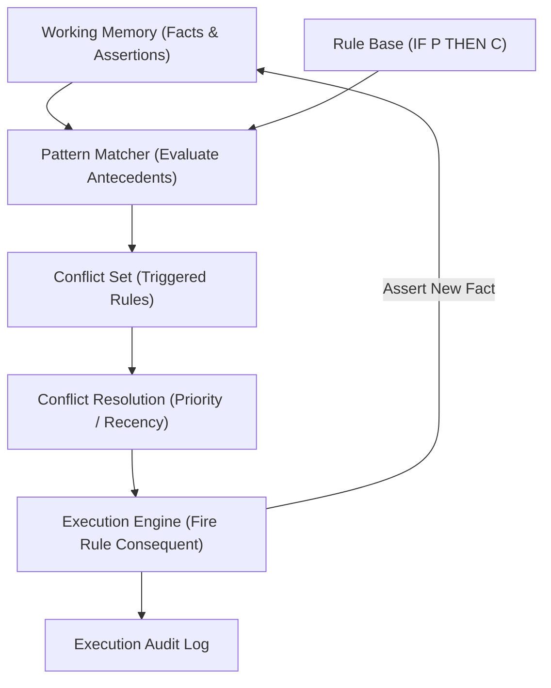
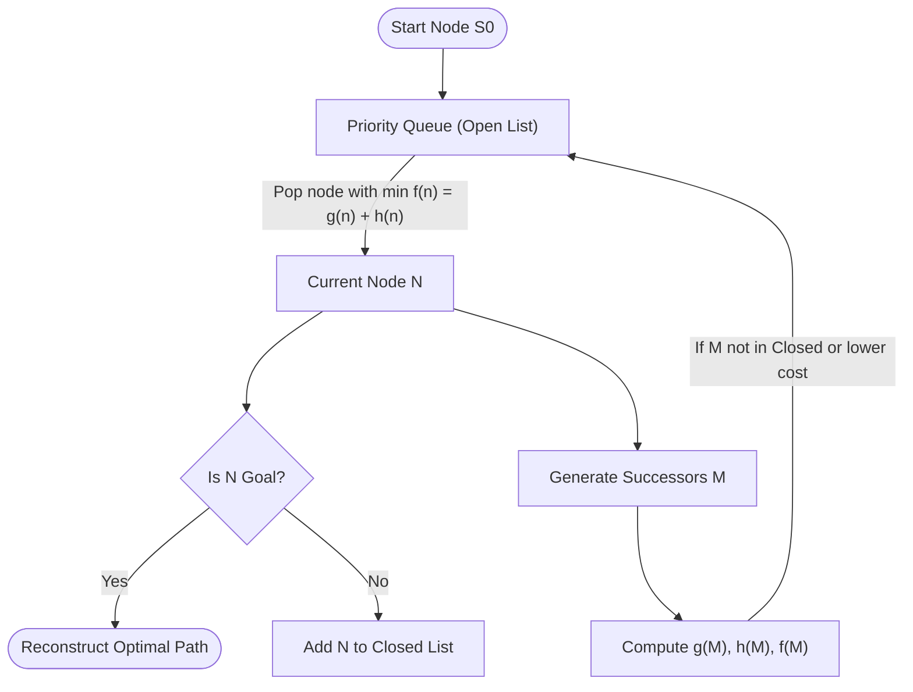
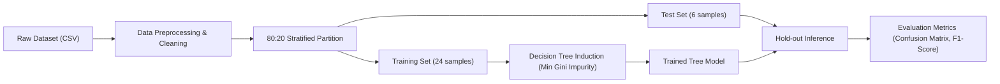
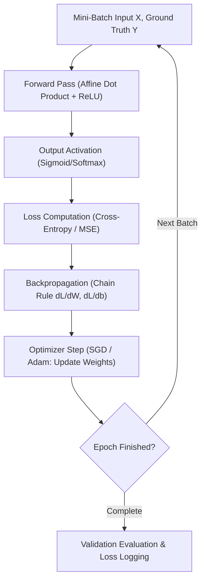

# System & Algorithm Architecture Diagrams

**Student:** Khushi Dixit | **Roll Number:** IC-2K23-51 | **Course:** IC-709D  
**Subject:** Artificial Intelligence Lab  

---

## 1. Production Rule Forward-Chaining Engine (Lab 1 & Lab 4)

---

## 2. A* Search Evaluation Cycle (Lab 2)

---

## 3. Machine Learning Decision Pipeline (Lab 5)

---

## 4. Deep Learning Training & Backprop Loop (Lab 6)

---

## 5. Grad-CAM Visual Explainability Pipeline (Lab 7)

```mermaid
flowchart LR
    IMG["Input Image"] --> CNN["Conv Layers Backbone"]
    CNN --> ACT["Terminal Conv Activation Maps A^k"]
    ACT --> HEAD["Classification Head"]
    HEAD --> SCORE["Target Class Score Y^c"]
    SCORE --> GRAD["Backprop Gradient dY^c / dA^k"]
    GRAD --> GAP["Global Average Pooling (Weights alpha_k)"]
    ACT --> COMB["Weighted Linear Combination"]
    GAP --> COMB
    COMB --> RELU["ReLU Filter (Positive Evidence)"]
    RELU --> HEATMAP["Grad-CAM Saliency Map"]
    HEATMAP --> OVERLAY["Superimposed Heatmap on Input"]
```

